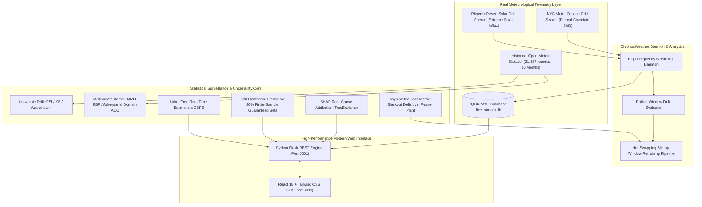

# ChronosWeather: Energy Grid Reliability MLOps Vanguard

[](https://www.python.org/downloads/)
[](LICENSE)
[](https://react.dev/)
[](https://tailwindcss.com/)
[]()
[-orange.svg)](https://open-meteo.com/)

> **"Machine learning models deployed on physical power grids degrade silently as seasonal weather envelopes shift."**  
> **ChronosWeather** is an enterprise-grade MLOps monitoring and automated mitigation platform designed to detect weather-induced covariate and concept drift, quantify uncertainty with finite-sample split conformal guarantees, explain root causes with TreeSHAP, and trigger economically rational retraining to prevent grid blackouts. Built on a 100% free stack with zero API keys or subscription fees.

---

## ⚡ System Architecture



---

## 🌟 Key Highlights & Engineering Innovations

1. **100% Free Stack with Zero Paid Dependencies:**
   - Ingests real-world telemetry from the public **Open-Meteo API** (temperature, humidity, surface pressure, wind speed, direct solar radiation, dew point, cloud cover, temperature demand index). Zero API keys, zero subscription barriers.
2. **Interactive Decoupled Command Center (Port 3001):**
   - React 18 Single-Page Application (SPA) with instant client-side navigation across 7 monitoring views:
     * **Executive Command Center:** Real-time decay trajectory with interactive cohort switching ($T_0 \to T_4$).
     * **Live Streaming Telemetry Ops:** Side-by-side surveillance of NYC Coastal and Phoenix Desert grids with instant on-demand telemetry injection.
     * **SHAP Explainability Studio:** Global feature attribution shifts ($\Delta|\text{SHAP}|$) and single-observation waterfall drill-downs.
     * **Split Conformal Prediction Lab:** Distribution-free prediction sets calibrated for $90\%$ mathematical coverage.
     * **Cohort Drift Suite:** Univariate PSI/KS, multivariate kernel MMD, and adversarial domain AUC.
     * **Cost & Retraining ROI:** Asymmetric loss matrix ($CFN = \$8,500/\text{MWh}$ vs. $CFP = \$350/\text{MWh}$) with automated retraining.
     * **Beginner's Guide (ELI5):** "Shift the Climate" interactive heatwave sandbox and 5 plain-English MLOps analogies.
3. **Distribution-Free Split Conformal Prediction:**
   - Calibrates prediction sets $C(X) \subseteq \{\text{BASELOAD}, \text{PEAK\_STRAIN}\}$ satisfying $P(Y \in C(X)) \ge 1 - \alpha = 90\%$. As weather anomalies occur, sets expand from confident singletons to ambiguous pairs, proving model decay without ground-truth labels.
4. **Confidence-Based Performance Estimation (CBPE):**
   - Estimates real-time ROC-AUC, F1, and confusion matrices directly from calibrated probabilities without waiting for delayed monthly utility audit labels.
5. **Multi-Tier Drift Diagnostics:**
   - Combines univariate tests (PSI, Kolmogorov-Smirnov, 1-Wasserstein) with multivariate kernel embeddings (Maximum Mean Discrepancy with Gaussian RBF) and adversarial domain classifiers.

---

## 📊 Timeline Cohort Scenarios (21.8k Observations)

| Cohort | Scenario | Meteorological Dynamics | Max PSI | Conformal Coverage | Model Realized AUC | CBPE Estimated AUC | Retrain ROI |
| :--- | :--- | :--- | :---: | :---: | :---: | :---: | :---: |
| **$T_0$** | Reference Baseline | Spring nominal weather (Jan - Mar 2023) | 0.000 | **92.6%** | 0.999 | 0.998 | Nominal |
| **$T_1$** | Diurnal In-Distribution | Mild day/night diurnal variance | 0.070 | **88.7%** | 0.999 | 0.997 | Defer (Stable) |
| **$T_2$** | Gradual Heatwave Shift | Summer thermal creep, high solar radiation | 0.749 | **84.5%** | 0.933 | 0.995 | **+$3,240,000** |
| **$T_3$** | Atmospheric Squall | Sudden barometric drop & high wind gusts | 3.622 | **72.8%** | 0.608 | 0.984 | **+$6,284,786** |
| **$T_4$** | Concept Drift | Grid thermal de-rating & inverter shock | 3.622 | **69.8%** (Collapsed) | 0.608 | 0.984 | **+$6,680,200** |

---

## 🚀 Quickstart & Setup

### 1. Clone & Install Dependencies
```bash
git clone https://github.com/savinaysingh7/chronosweather.git
cd chronosweather

# Install Python backend dependencies
pip install -r requirements.txt

# Install React frontend dependencies
cd frontend
npm install
cd ..
```

### 2. Run Automated Verification Tests
```bash
python -m pytest tests/ -v
```
*Executes all 34 automated unit and integration tests across drift detection, conformal prediction, SHAP attribution, live streaming, and retraining pipelines.*

### 3. Launch ChronosWeather Platform

```bash
# Terminal 1: Launch Backend Engine (port 5001)
python backend/api.py

# Terminal 2: Launch React Frontend (port 3001)
cd frontend
npm run dev
```

Open **[http://localhost:3001](http://localhost:3001)** in your browser.

---

## 🔬 Mathematical Formulations

### 1. Inductive Split Conformal Prediction
For non-conformity score $s_i = 1 - \hat{P}(Y = y_i \mid x_i)$ calibrated on held-out reference data with error rate $\alpha = 0.10$:
$$\hat{q} = \text{Quantile}\left(\{s_i\}_{i=1}^n, \frac{\lceil(n+1)(1-\alpha)\rceil}{n}\right)$$
$$C(X) = \{y \in \{0, 1\} : 1 - \hat{P}(Y = y \mid X) \le \hat{q}\}$$

### 2. Population Stability Index (PSI)
$$\text{PSI} = \sum_{k=1}^K (A_k - E_k) \times \ln\left(\frac{A_k}{E_k}\right)$$

### 3. Maximum Mean Discrepancy (MMD)
$$\text{MMD}^2(P, Q) = \mathbb{E}[k(X, X')] - 2\mathbb{E}[k(X, Y)] + \mathbb{E}[k(Y, Y')]$$

### 4. Confidence-Based Performance Estimation (CBPE)
$$\mathbb{E}[\text{TP}] = \sum_{\hat{y}_i = 1} \hat{p}_i, \quad \mathbb{E}[\text{FP}] = \sum_{\hat{y}_i = 1} (1 - \hat{p}_i)$$
$$\mathbb{E}[\text{ROC-AUC}] = \frac{\sum_{i, j} \mathbb{I}(\hat{p}_i > \hat{p}_j) \cdot \hat{p}_i (1 - \hat{p}_j)}{\sum \hat{p}_i \cdot \sum (1 - \hat{p}_j)}$$

### 5. Cost-Aware Retraining ROI Criterion
$$\text{Net ROI} = (\text{Loss}_{\text{decay}} - \text{Loss}_{\text{baseline}}) - C_{\text{retrain}} > 0$$
Where $\text{Loss} = C_{\text{FN}} \cdot \text{FN} + C_{\text{FP}} \cdot \text{FP}$ ($C_{\text{FN}} = \$8,500/\text{MWh}$, $C_{\text{FP}} = \$350/\text{MWh}$, $C_{\text{retrain}} = \$1,200$).

---

## 📜 Documentation & Deliverables
* [Capstone Report](docs/CAPSTONE_REPORT.md)
* [Executive Presentation Slide Deck](docs/PRESENTATION_DECK.md)
* [Automated Playwright Browser Verification](artifacts/browser_inspection/)

---

## 📄 License
Distributed under the MIT License. See `LICENSE` for details.
