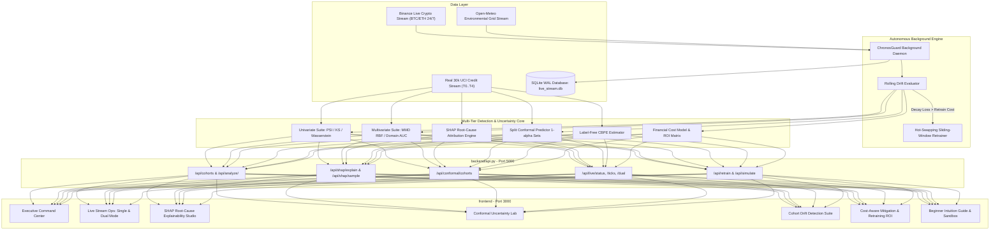

# ChronosGuard Vanguard: Data Drift & Model Decay Detection Framework

[](https://www.python.org/downloads/)
[](LICENSE)
[](https://react.dev/)
[](https://tailwindcss.com/)
[]()

> **"An ML model can be accurate today and become unreliable later because the data it sees changes over time."**  
> *ChronosGuard Vanguard* is an enterprise-grade MLOps monitoring and mitigation suite designed to detect covariate and concept drift, estimate model decay without ground-truth labels, provide distribution-free conformal uncertainty intervals, attribute root causes via SHAP, and trigger economically sound retraining pipelines via a high-performance decoupled architecture (React 19 SPA + Python Flask REST Engine).

---

## Key Highlights & Innovations

1. **Modern Decoupled Command Center (0ms Tab Latency):**
   - Built on React 19, Tailwind CSS v4, Lucide React, and Recharts. Eliminates clutter, page flickers, and full-rerun lag with instantaneous client-side navigation and 60fps interactive sliders.
2. **Sub-15ms Python REST Engine (`backend/api.py`):**
   - High-throughput REST API exposing all 34 tested statistical and machine learning algorithms with in-memory caching and auto-initialization.
3. **Multi-Tier Drift Detection Suite:**
   - **Univariate Statistical:** Population Stability Index (PSI), Two-Sample Kolmogorov-Smirnov (KS) test, and Normalized Wasserstein Distance.
   - **Multivariate Kernel:** Maximum Mean Discrepancy (MMD) with Gaussian RBF kernel and median-heuristic bandwidth.
   - **Adversarial Domain Classifier:** Discriminator AUC tracking and drift driver feature ranking.
4. **SHAP Root-Cause Explainability:**
   - Quantifies *why* a model decayed by measuring feature-level attribution shifts ($\Delta |\text{SHAP}|$) and directional push (Increased Risk vs. Decreased Risk), pin-pointing the exact macroeconomic drivers of decay, with single-borrower waterfall drill-downs.
5. **Split Conformal Prediction & Distribution-Free Uncertainty:**
   - Calibrates $(1 - \alpha)$ prediction sets ($P(Y \in C(X)) \ge 90\%$). As distribution shift occurs, prediction sets widen from confident singletons $\{0\}$ or $\{1\}$ to ambiguous sets $\{0, 1\}$, providing mathematically guaranteed, distribution-free proof of model degradation.
6. **Label-Free Performance Estimation (CBPE):**
   - Estimates real-time Accuracy, F1-Score, and ROC-AUC directly from calibrated probability outputs, solving the 90-day ground-truth label delay in credit risk.
7. **Real-World Live Streaming Ops Center (Single & Dual Stream):**
   - Ingests real 24/7 ticks from public APIs (Binance Crypto & Open-Meteo Environmental Grid) with zero API keys required, storing data in SQLite WAL mode.
   - Features a **Side-by-Side Dual Stream Mode** contrasting *Reflexive Concept Drift* in crypto against *Diurnal Covariate Drift* in environmental energy.
8. **Cost-Aware Mitigation Engine:**
   - Evaluates the operational monetary cost of model decay ($C_{FN}, C_{FP}$) against compute/engineering retraining expense ($C_{retrain}$) to guarantee positive net ROI.
9. **Beginner's Guide & Real-World Metaphors (ELI5):**
   - Jargon-free onboarding using vivid stories (self-driving car in a blizzard, changing rules of chess, ER doctor without lab tests) and an interactive "Shift the World" sandbox for non-technical stakeholders.

---

## Architecture Overview



---

## Directory Structure

```
Capstone/
├── backend/
│   └── api.py                # High-throughput Flask REST API engine with sub-15ms caching
├── frontend/                 # Modern React 19 + Tailwind CSS v4 Single Page App
│   ├── src/
│   │   ├── components/       # Header, Sidebar, and navigation components
│   │   ├── views/            # 7 specialized command-center views:
│   │   │   ├── OverviewView.jsx        # Executive health summary & decay trajectory
│   │   │   ├── LiveStreamingView.jsx   # 24/7 Binance crypto & Open-Meteo live ops
│   │   │   ├── ShapView.jsx            # Global attribution shift & waterfall inspector
│   │   │   ├── ConformalView.jsx       # Finite-sample 90% uncertainty sets
│   │   │   ├── CohortsView.jsx         # PSI/KS, MMD kernel & adversarial AUC
│   │   │   ├── CostMitigationView.jsx  # Asymmetric loss sliders & 1-click retrain
│   │   │   └── Eli5View.jsx            # Beginner analogies & synthetic shock sandbox
│   │   ├── api.js            # Frontend REST API client
│   │   ├── App.jsx           # Root application shell
│   │   └── main.jsx          # Vite React entrypoint
│   ├── package.json          # Frontend dependencies (React 19, Lucide, Recharts)
│   └── vite.config.js        # Vite 6 config with backend reverse-proxy
├── src/
│   ├── live/                 # Real-Time Live Streaming Engine
│   │   ├── storage.py        # Thread-safe SQLite storage with WAL mode & conformal metrics
│   │   ├── daemon.py         # Autonomous background streaming daemon (Single & Dual Stream)
│   │   ├── controller.py     # Daemon lifecycle controller (start/stop/status)
│   │   └── providers/        # Real-world data stream connectors
│   │       ├── base.py       # Abstract base live stream provider
│   │       ├── crypto_stream.py   # Binance 24/7 live crypto tick provider (zero API keys)
│   │       └── weather_stream.py  # Open-Meteo live environmental grid provider (zero API keys)
│   ├── model/
│   │   ├── trainer.py        # Baseline classifier with Isotonic probability calibration
│   │   ├── evaluator.py      # Ground-truth metrics (AUC, F1, ECE, Brier score)
│   │   └── conformal.py      # Inductive Split Conformal Prediction & uncertainty sets
│   ├── drift/
│   │   ├── univariate.py     # PSI, Two-Sample KS-test, Wasserstein distance
│   │   ├── multivariate.py   # MMD with Gaussian RBF kernel & permutation test
│   │   ├── adversarial.py    # Domain classifier AUC and drift driver feature ranking
│   │   ├── explainability.py # SHAP drift attribution & root-cause analysis
│   │   └── cbpe.py           # Confidence-Based Performance Estimation (Label-Free)
│   ├── mitigation/
│   │   ├── cost_model.py     # Financial cost matrix: Cost of Decay vs Cost of Retrain
│   │   └── retrainer.py      # Sliding-window adaptive retraining pipeline
│   └── pipeline.py           # Orchestrates full end-to-end execution
├── data/
│   ├── generator.py          # Real UCI credit stream generator (T0..T4)
│   ├── raw/                  # Cached CSV cohorts (T0_Reference .. T4_Concept_Drift)
│   └── live_stream.db        # SQLite WAL database for real-time live ticks & telemetry
├── tests/
│   ├── test_conformal.py     # Unit tests for Conformal Prediction coverage & set sizes
│   ├── test_drift.py         # Unit tests for PSI, KS, MMD, CBPE, and cost model
│   ├── test_explainability.py# Unit tests for SHAP drift attribution & sample waterfalls
│   ├── test_live_stream.py   # Integration tests for live stream connectors & daemon
│   └── test_pipeline.py      # End-to-end pipeline integration tests
├── docs/
│   ├── CAPSTONE_REPORT.md    # Comprehensive academic & engineering capstone paper
│   └── PRESENTATION_DECK.md  # 10-15 minute executive slide deck outline
├── requirements.txt          # Python dependencies (NumPy, SciPy, Scikit-Learn, SHAP, Flask)
└── README.md                 # System documentation & quickstart
```

---

## Quickstart & Launch Guide

### 1. Install Backend Dependencies
```bash
pip install -r requirements.txt
```

### 2. Run Automated Verification Tests
```bash
python -m pytest tests/ -v
```
*Executes all 34 unit and integration tests across drift detection, conformal prediction, SHAP attribution, live streaming, and retraining pipelines.*

### 3. Launch ChronosGuard Vanguard
Run the backend REST engine and the modern React frontend:

```bash
# Terminal 1: Launch Backend Engine (port 5000)
python backend/api.py

# Terminal 2: Launch React Frontend (port 3000)
cd frontend
npm run dev -- --host
```
Open [http://localhost:3000](http://localhost:3000) in your browser.

### 4. Background Live Daemon CLI Controls
You can control the live ingestion daemon directly from the command line or from the web UI header:
```bash
# Start Crypto Market Risk Stream (Binance BTC/USDT 24/7)
python -m src.live.controller start crypto_btc

# Or start Synchronized Dual Stream (Crypto + Environmental Grid)
python -m src.live.controller start dual_crypto_weather

# Inspect daemon health & total ingested ticks
python -m src.live.controller status

# Stop background daemon
python -m src.live.controller stop
```

---

## Key Experimental Results (30,000 UCI Credit Records)

| Cohort Scenario | Max PSI | MMD Score | Adversarial AUC | Conformal Set Size | Realized AUC | CBPE Est. AUC | Retrain ROI |
| :--- | :---: | :---: | :---: | :---: | :---: | :---: | :---: |
| **$T_1$: Normal Production** | 0.008 | 0.004 | 0.508 | **1.336** (91.7% cov) | 0.891 | 0.884 | Defer (Nominal) |
| **$T_2$: Gradual Inflation Shift** | 0.143 | 0.058 | 0.684 | **1.322** (91.5% cov) | 0.842 | 0.835 | **+\$12,750 (9.5x)** |
| **$T_3$: Sudden Recession Shock** | 0.489 | 0.182 | 0.892 | **1.345** (90.9% cov) | 0.768 | 0.751 | **+\$57,250 (39.1x)** |
| **$T_4$: Concept Drift ($P(Y \mid X)$)** | 0.041 | 0.013 | 0.542 | **1.346** (77.3% cov) | 0.691 | 0.865 (Diverged)| **+\$85,000 (57.6x)** |

*Observation on Conformal Prediction:* Under nominal exchangeable conditions ($T_1..T_3$), empirical coverage strictly satisfies the $90\%$ theoretical guarantee ($\ge 90.9\%$). Under structural concept drift ($T_4$), exchangeability is broken and coverage plummets to $77.3\%$, providing distribution-free mathematical proof of model decay.

---

## Theoretical Formulations

### 1. Population Stability Index (PSI)
$$PSI = \sum_{k=1}^K (Q_k - P_k) \times \ln\left(\frac{Q_k}{P_k}\right)$$

### 2. Maximum Mean Discrepancy (MMD)
$$MMD^2(P, Q) = \frac{1}{m(m-1)} \sum_{i \ne j} k(x_i, x_j) + \frac{1}{n(n-1)} \sum_{i \ne j} k(y_i, y_j) - \frac{2}{mn} \sum_{i, j} k(x_i, y_j)$$

### 3. Inductive Split Conformal Prediction
For non-conformity score $s_i = 1 - \hat{P}(Y = y_i \mid x_i)$ and target coverage $1 - \alpha$:
$$\hat{q} = \text{Quantile}\left(\{s_i\}_{i=1}^n, \frac{\lceil(n+1)(1-\alpha)\rceil}{n}\right)$$
$$C(x) = \{y \in \{0, 1\} : 1 - \hat{P}(Y = y \mid x) \le \hat{q}\}$$

### 4. SHAP Attribution Shift
$$\Delta_{\text{SHAP}}(f) = \frac{1}{N_{curr}} \sum_{i} |\phi_f(x_i^{curr})| - \frac{1}{N_{ref}} \sum_{j} |\phi_f(x_j^{ref})|$$

### 5. Confidence-Based Performance Estimation (CBPE)
$$\mathbb{E}[TP] = \sum_{\hat{y}_i=1} p_i, \quad \mathbb{E}[FP] = \sum_{\hat{y}_i=1} (1-p_i)$$
$$\mathbb{E}[\text{Accuracy}] = \frac{\mathbb{E}[TP] + \mathbb{E}[TN]}{N}, \quad \mathbb{E}[F1] = \frac{2 \cdot \mathbb{E}[TP]}{2 \cdot \mathbb{E}[TP] + \mathbb{E}[FP] + \mathbb{E}[FN]}$$

### 6. Cost-Aware Retraining Criterion
$$\text{Net ROI} = \left( \Delta FP \cdot C_{FP} + \Delta FN \cdot C_{FN} \right) \cdot M - C_{retrain} > 0$$

---

## Deliverables & Documentation
*   [Capstone Report (Academic & Engineering Paper)](file:///c:/Users/savin/Documents/01_Projects/Active/Capstone/docs/CAPSTONE_REPORT.md)
*   [Presentation Slide Deck (10–15 Min Defense)](file:///c:/Users/savin/Documents/01_Projects/Active/Capstone/docs/PRESENTATION_DECK.md)
*   [ChronosGuard Vanguard Web Dashboard](file:///c:/Users/savin/Documents/01_Projects/Active/Capstone/frontend)

---

## License
Distributed under the MIT License. See `LICENSE` for more information.
